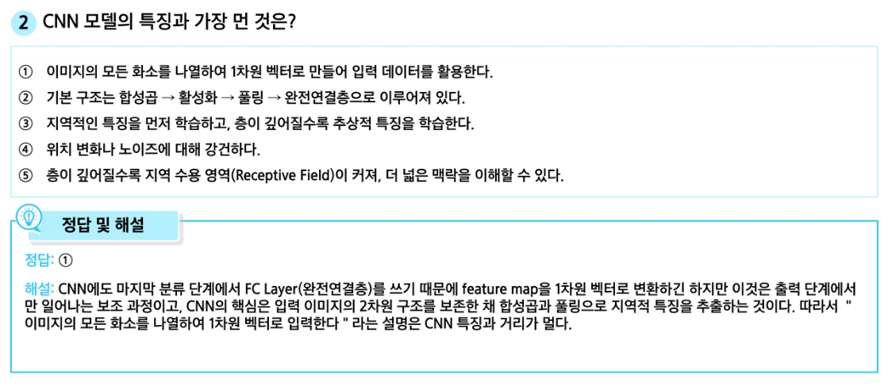
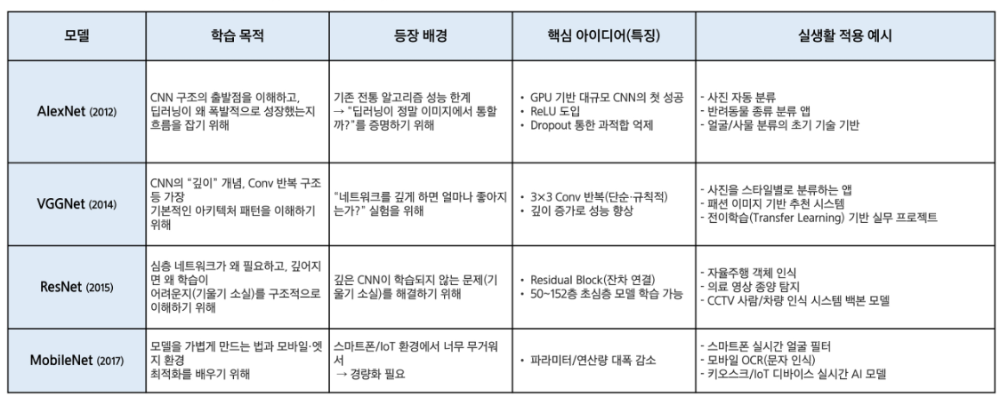

## Dl & vision model ##

> CNN
```
FCN = 완전연결층 / 입력을 받아서 출력 변환

합성곱 레이어
입력 이미지를 필터와 연산하여 특징 맵을 뽑아내는 모듈
3차원 구조를 그대로 보존하면서 연산

Convouluton: 필터를 이미지 상에서 이동시키면서 내적 반복수행
filter는 항상 입력의 깊이/채널축과 동일한 차원
    필요연산: (3*5*5) 차원의 내적곱 + bias 벡터 
    WTx + b (w: 필터의 가중치, x: 필터가 덮는 이미지 영역, b: 편향)
    필터의 이동경로에 따라 모든 연산 값을 모아 활성화 맵 출력
    입력 대비 출력 공간 해상도가 줄어듬

    **출력해상도는 입력해상도 - 필터해상도 +1 로 도출
    만약 입출력 해상도 유지원하면 -> 출력값 중 정의되지않은 경우, 0 혹은 가장 가까운 출력값으로 대체


모델 상수(파라미터)를 증가시키면? -> 비선형 블록과 함께하면 모델링 파워 향상
                                conv[Linear] + ReLU[비선형변환]

필터시각화: 학습된 필터 시각화를 통해 각 모델이 학습한 정보를 이해가능

중첩과 수용영역: CNN레이어는 이미지 작은 부분인 지역정보를 추출하는데 유리하게 설계
               이미지 활용하는 다양한 작업에서 이미지 전체 의미 파악 필요
               따라서 지역정보+이미지 전체의 맥락을 이해/활용하기 위한 설계 필요
               -> Conv layer 깊게 쌓는 구조

수용영역: cnn 이미지를 처리하면서 한번에 볼 수 있는 영역 크기(네트워크 시야)
         깊어질수록 수용영역도 넓어짐
         고해상도 처리시 많은 레이어 통과 / 연산 비용 학습가능성 고려시 비실용적
         실제해법: 입력사이즈를 줄여 모델에 입력

풀링: 효율적 연산 및 위치변화의 강건성 확보
     CNN 레이어의 출력을 줄여 연산 효율성을 확보, 입력크기가 줄면 CNN 연산량이 줄어듬
     위치변화 강건성: 입력 내 객체 위치가 다소 변해도 동일한 출력 제공
     사실상 저해상도 정보에 근거하여 작업 수행 -> 몇 화소 이동은 무시됨
     Max_Polling = 정해진 커널 사이즈로 이미지를 나누어 각 영역 내 가장 큰 값 선택

스트라이드 합성곱: 풀링 한계 개선
    일반 합성곱: 필터를 1칸씩 이동하면서 연산 수행(출력값 계산)
    스트라이드 합성곱: 필터를 스트라이드 값만큼 (s칸) 이동한 후 출력 연산
    효과: 풀링처럼 입력해상도를 줄임(연산효율과 위치 강건성)
    *스트라이드는 커널을 동시에 학습
    *해상도 저하로 인한 정보 손실이 적고, 풀링+합성곱을 하나의 레이어로 대체
    *고도화된 cnn에서는 스트라이드 합성곱을 풀링 대신 활용하는 경향

```

> CNN 모델
```
AlexNet
- 5개의 합성곱 계층과 3개의 fcn 계층으로 구성된 8계층 모델 / ReLU, 맥스풀링
- 입력: 이미지 (3*227*227) / 출력: 레이블 (1*1024벡터)
- 학습시 정답은 원-핫 벡터, 모델 예측값은 0~1 사이의 확률값

출력사이즈
- 출력채널수 = 현재 레이어의 필터 개수
- 출력해상도 = W' = (사이즈 + 커널 + 2*패딩 / 스트라이드) + 1
- 출력메모리 = 입력채널 * 사이즈 * 사이즈
- 상수 K = 파라미터수 = 출력채널수 * 입력채널수 * 커널제곱값 + 출력채널수
- Flops = 연산량 = 출력원소수 * 출력 원소별 연산


VGGNet
- 5개의 합성곱블록과 맥스풀링 구조 (19계층) / ReLU 구조 반복
- 각 블록당 맥스풀링, 3개 연결층 레이어 + 16개의 합성곱
- 입력: 이미지 (3*224*224) / 출력: 레이블 (1*1024벡터)

-> 작고 단순한 필터를 깊게 쌓으면 성능 UP 제시

디자인룰: 3X3 합성곱 / 스트라이드 1 / 패딩 1 반복
         맥스풀링(2X2) 크기 줄이기
         풀링 후, 채널 크기 2배 적용
         *VGG는 해상도를 줄일때마다 채널을 늘려 레이어별 연산량 차이 줄임

모델특징: 단순함+깊이의 강력한 성능, 모델해석에 이상적
         특징추출기, 전이학습에 강력한 베이스라인
         *파라미터가 많고 연산량 요구가 매우 큼


ResNet
- 합성곱 블록(VGG유사)과 잔차(Residual) 블록
- 잔차블록은 블록입력을 그대로 출력에 더해주는 연결 특징
- Inception 모델에서 차원축소로 활용된 1x1 합성곱 적용, 연산효율 개선
- 입력: 이미지 (3*224*224) / 출력: 레이블 (1*1024벡터)


등장배경: 배치 정규화 방식으로 10+ 레이어 학습 가능
         -> 깊다고 무조건 더 잘 학습되지는 않음
         -> 단순히 레이어를 깊게 하면 오히려 성능이 떨어짐

아이디어: 배치 정규화 방식으로 10+ 레이어 학습 가능
         작은 모델의 성능은 최소한 누릴 수 있도록 추정값 그대로 후속에 제공하여 성능보장

잔차블록: 입력 x가 두 경로로 나뉘어 전달됨
          - 1) 변환경로(f(x)) conv->relu->conv ...
          - 2) shortcut 경로(잔차연결) = 입력 x 그대로 전달
         마지막에 두값을 더함 F(x) + x
         잘안된다면 F(x) = 0이 될수도 있고, 그래도 최소 성능은 보장

         BottleNet 잔차: 연산효율 목적, 더 깊은 모델, 더 적은 연산 달성

Stem 구조: 기존 모델의 효율성 레시피를 잘 활용
           -1) 스템 구조 모델 초기 도입, 입구데이터 해상도를 1/4로 줄이고 잔차블록 적용 
           -2) 여러개 FC레이어 제거, 전역 평균 풀링 사용 -> 마지막 1개 FC만 적용

그외: ResNet-34, ResNet-50 차이는 잔차블록 vs 보틀넥 잔착 블록 사용 여부
      ResNet-50 지금도 활발히 사용


MobileNet
- 모바일 임베디드 환경에서 구동가능
- 기존 합성곱은 공간과 채널을 동시 처리하여 연산량 과도하게 요구됨
- 아이디어: 공간과 채널을 두 단계로 분리하여 처리
           - 깊이별 합성곱: 각 채널별 독립적 3x3
           - 화소별 합성곱: 1x1 합성곱을 채널방향으로 적용
- 효과: 연산량 기존 대비 9배 절감, 모델 상수 대폭 감소
- 영향력: 가볍고 빠른 모델로 엣지 디바이스에서 실행가능함을 보임
         효율형 모델 구조의 표준 제시 -> 깊이별 합성곱과 보틀넥 구조 지속 채택




```