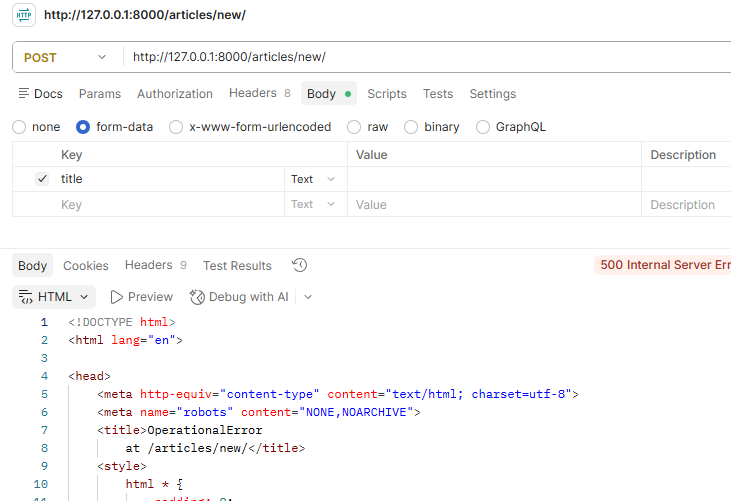

## Django 2일차 ##

>모델 생성
```
from django.db import models

class Article(models.Model):   # -> 객체를 정의 -> 상속을 통해

    # 제목과 내용을 정의
    # 글자수와 공간의 차이를 두기 위해 따로 따로 씀

    #모델 클래스는 == 테이블 설계도!
    title = models.CharField(max_length=100) #글자제한
    content = models.TextField() #글자제한 없음
    
    def __str__(self):
        return self.title
```

> MIGRATIONS
```
MODE 클래스 변경사항(필드생성, 수정삭제 등) DB에 최종 반영

-설계도 초안을 MODELS.PY에서 생성
-Migration 파일로 최종 설계도 제작
-db에 최종적으로 이주 시킴


python manage.py makemigrations  #이주공간생성

-> Migrations for 'articles':
    articles\migrations\0001_initial.py
    + Create model Article

아이디 자동으로 생성

python manage.py showmigrations  #설계도만 있고 아직 적용안됨
python manage.py migrate         #설계도에 적용시키기
python manage.py makemigrations  #업데이트된걸 새 설계도로 추가

# 1번 누르고 -> 현재시각 기준으로 원하면 ENTER
python manage.py migrate         #이미 설계도가 있으면 그냥 이걸 치면 됨
```

> Admin site
```
python manage.py createsuperuser # 슈퍼유저 정보 추가

#admin.py에서 
from .models import Article

# 관리자. 사이트. 등록(article)
admin.site.register(Article)
```

>ORM(통역가)
```
객체 지향 프밍언를 사용하여 호환X 유형 시스템 간에 데이터 변환 기술


#QuerySet API 
ORM 에서 데이터를 검색, 필터링, 그룹화 하는데 사용도구 / Python 기반으로
DB에 데이터 저장, 조회, 수정, 삭제 = CROD

Article.objects.all()
 모델    매니저   queryset API

 모델을 매니저가 관리 -> 어떤 행동을 취할지 정의

header: 설정
body: 내용


```


> 코드 기본 구조 흐름 (여기부분 흐름만 확실하면 괜찮을 듯?)
```
모델 정보 및 정보 생성 기능 구현

1. 모델 파일 만들기: model.py에서 Class 파일을 만들기 (models.Model!!)
   # 여기 단계가 정의를 하는게 아니라 이미 정의된 ERD 기반으로 코드를 짜는것!

   class Patient(models.Model):
   first_name = models.CharField(max_length=30)

2. 모델 migration 하기!
   python manage.py makemigrations
   python manage.py migrate

3. Serializers.py 작성하기!
   우선 app 폴더에 파일 생성
   
   from rest_framework import serializers
   from .models import Patient (클래스 모델명으로 호출)
   
   class PatientSerializer(serializers.ModelSerializer):  ## 모델에서 가져오니까
        class Meta:  #meta(설명정보)
            model = Patient    # 모델에서 정의
            fields = '__all__' # 필드에서 가져올 정보들/ 전체는 __all__
            #fields = ['first_name', 'last_name']

    -> 추가적인 serializers가 필요하다면 동일 파일에 다른 이름으로 추가하기!

4. views.py 작성

   from rest_framework.response import Response
   from rest_framework.decorators import api_view
   from rest_framework import status
   from .models import Patient
   from .serializers import PatientSerializer

   @api_view(['POST'])
   def patient_create(requeset):
        serializer = PatientSerializer(data=request.data) #데이터 지정
        if serializer.is_valid(raise_excetion = True):
            serializer.save()
            return Response(serailizer.data, status= status.HTTP_201_CREATED) #왜 serializer.data?


# 만약 여러개 CRUD를 써야한다면
    @api_view(['GET', 'POST'])
    def post_list(request):
        #1 목록조회
        if request.method == 'GET':
            posts  = Post.objects.all() # 다 쓰겠다
            serializer = PostSerializer(posts, many=True)  #many=True 써야 여러개 다 반환 / 이거 조금더 이해 필요
            return Response(serializer.data)

        #2 게시글 작성
        elif request.method == 'POST':
            serializer = PostSerializer(data=request.data)
            if serializer.is_valid(raise_exception = True):
                serializer.save()
                return Response(serializer.data, status= status.HTTP_200_OK)

    @api_view(['GET', 'PUT', 'DELETE'])

    def post_detail(request, pk):
        post = post.objects.get(pk=pk)  # -> 주소 추가 값이구나!

        #1 단건조회
        if request.method == 'GET':
            serializer = PostSerializer(post)
            return Response(serializer.data)

        #2 수정
        elif request.method == 'PUT':
            serializer = PostSerializer(post, data=request.data) #수정시에는 같이 넘겨야함 (원본, 수정)
            if serializer.is_valid(raise_exception = True):
                serializer.save()
                return Response(serializer.data, status= status.HTTP_200_OK)

        #3 삭제
        elif request.method == 'DELETE':
            post.delete()
            return Response(
                {'message': 'Post delated successfully'}, #출력되는 메세지!!! 이방식도 알아야할듯?
                status = status.HTTP_204_NO_CONTENT
            )

# 추가사항들
from rest_framework.generics import get_object_or_404 (return 마지막 부분을 생략)

@api_view(['GET'])
def patient_detail(request, pk):
    patient = get_object_or_404(Patient, pk=pk) -> 이런 형태로 넣기!
    serializer = PatientListSerializer(patient)
    return Response(serializer.data)


5. urls.py view 연결
    app urls에서는 앞쪽에 결과값과 동일한 주소값이 되도록 추가, views의 함수 가져오기

# pk값을 쓰게되면 <int:pk> 형태!!
urlpatterns = [
    path("new/", views.patient_create),
    path("<int:pk>/", views.patient_detail),   
]

```


> 실습코드 
```
from django.http import JsonResponse
from rest_framework.decorators import api_view
from rest_framework import status
from .models import Article

# 규칙을 보여주는 공간
def model_to_dict(article):  
    '''
    Article 객체를 딕셔너리로 변환하는 함수
    :param article: Article 객체
    :return: Article 객체를 딕셔너리로 변환한 결과
    '''
    return {
        'id': article.id,
        'title': article.title,
        'content': article.content
    }


@api_view(['POST'])
def article_create(request):
    # 데이터 객체를 만드는(생성하는) 첫번째 방법
    article = Article() 
    
    article.title = request.data.get('title') 
    article.content = request.data.get('content')
    
    # 데이터 객체를 만드는(생성하는) 두번째 방법
    # article = Article(title=request.data.get('title'), content=request.data.get('content'))
    
    article.save() # 데이터베이스에 저장
    
    # 데이터베이스에 저장하는 세번째 방법  -> 위 두 방법과 달리 객체 생성과 동시에 데이터베이스에 저장됨
    # Article.objects.create(title=request.data.get('title'), content=request.data.get('content'))
    
    # 반환값으로 article.id와 status.HTTP_201_CREATED를 응답 코드로 반환
    return JsonResponse({'id': article.id}, status=status.HTTP_201_CREATED)

@api_view(['GET'])
def article_list(request):
    articles = Article.objects.all()  # 저장된 모든 article 데이터를 가져옴
    # title이 'article_02'인 데이터만 가져옴 존재하지 않으면 빈 리스트 반환
    # articles = Article.objects.filter(title='title1')
    
    # QeurySet 객체를 순회하며 각각의 데이터를 딕셔너리로 변환
    if articles:  # articles가 존재하면
        data = [model_to_dict(article) for article in articles]
        return JsonResponse({'data': data})  # articles가 존재하면 데이터를 반환
    return JsonResponse({'data': []})  # articles가 존재하지 않으면 빈 리스트 반환
    # return JsonResponse(data, safe=False)  # 딕셔너리가 아닌 데이터를 반환할 때 safe=False로 설정

@api_view(['GET'])
def article_detail(request, pk):
    article = Article.objects.get(pk=pk)
    # article = Article.objects.get(title='title')  # title 필드에 저장된 값이 'title'인 데이터를 가져옴
    return JsonResponse(model_to_dict(article))

@api_view(['PUT'])
def article_update(request, pk):
    article = Article.objects.get(pk=pk) # 수정할 article 데이터를 가져옴
    # 수정할 데이터를 request.data로부터 가져와서 수정
    article.title = request.data.get('title') 
    article.content = request.data.get('content') #덮어쓰기
    article.save() # 수정된 데이터를 저장
    return JsonResponse(model_to_dict(article))


@api_view(['DELETE'])
def article_delete(request, pk):   #무엇을삭제할지가 포함
    article = Article.objects.get(pk=pk)  # 삭제할 article 데이터를 가져옴
    article.delete() # 데이터 삭제
    return JsonResponse(status=status.HTTP_204_NO_CONTENT)

```

>Serializations
```
데이터 구조나 객체 상태를 나중에 재구성할 수 있는 포멧으로 변환하는 과정
파이썬 객체의 특정한 속성을 뽑아서 -> json으로 반환
어떠한 언어나 환경에서도 나중에 다시 쉽게 사용!

#Serializer
모델에 정의됐던 클래스의 필드에 맞춰서 진행

class ArticleListSerializer(serializers.ModelSerializer):
    class Meta:
        '''
        Meta 클래스는 Serializer 클래스의 내부 클래스로, 
        serializers 가 만들어지는 설계에 대한 메타데이터를 제공
        '''
        model = Article  # Model: 직렬화할 대상 모델
        exclude = ('created_at', 'updated_at',)  #제외대상 정의
        #fields = ('id', 'title', 'content')  /// fields = '__all__'  # 모든 필드 처리

@api_view(['GET', 'POST'])
def article_list(request):
    if request.method == 'GET':
        articles = Article.objects.all()  # 모든 Article 객체를 가져옴
        # Serializer를 통해 직렬화
        # many=True: 여러 개의 데이터를 직렬화할 때 사용
        serializer = ArticleListSerializer(articles, many=True) 
        return Response(serializer.data)  # 직렬화한 데이터를 Response로 반환
    elif request.method == 'POST': # 새로운 article을 생성
        serializer = ArticleSerializer(data=request.data)  # request로 전달받은 데이터를 serializer에 담음
        if serializer.is_valid():  # serializer를 통해 입력 데이터의 유효성 검사 
            serializer.save() # 유효성 검사를 통과하면 데이터베이스에 저장
            return Response(serializer.data, status=status.HTTP_201_CREATED)
        return Response(serializer.errors, status=status.HTTP_400_BAD_REQUEST)
        
        -> is_valid에 raise_exception=True 넣으면 return response가 자동으로 되어서 안해도 됨!

@api_view(['GET', 'DELETE', 'PUT'])
def article_detail(request, article_pk):
    article = Article.objects.get(pk=article_pk)
    if request.method == 'GET': # article 객체를 직렬화하여 반환
        serializer = ArticleSerializer(article)
        return Response(serializer.data)
    elif request.method == 'DELETE':
        article.delete()
        return Response(status=status.HTTP_204_NO_CONTENT)
    elif request.method == 'PUT':
        # instance: 업데이트할 article 객체
        # data: 업데이트할 데이터
        serializer = ArticleSerializer(article, data=request.data)
        # :partial = True로 설정하면 일부 필드만 업데이트 가능 // request Method Patch 일 때
        # serializer = ArticleSerializer(instance=article, data=request.data, partial=True)
        if serializer.is_valid():  # serializer를 통해 입력 데이터의 유효성 검사
            serializer.save()
            return Response(serializer.data)
        return Response(serializer.errors, status=status.HTTP_400_BAD_REQUEST)

```